<!--suppress HtmlDeprecatedAttribute, HtmlUnknownTarget -->
<div align="center">

# IBM Fault Analyzer for z/OS&reg;

[][github-issues]
[][vscode-fa]
[][vscode-pack]
[][ibm-support]

</div>

The IBM Fault Analyzer for z/OS&reg; VS Code extension works in conjunction with the
[Zowe Explorer][vscode-zowe] VS Code extension. IBM Fault Analyzer for z/OS&reg; helps
developers analyze and fix application and system failures.

When applications abnormally end (ABEND), it is crucial to understand the root cause.
IBM Fault Analyzer for z/OS&reg; can discover ABENDs faster, more confidently, and in less time
by automatically gathering real-time information of the ABEND and the environment at the time of failure.

> Simplify your installation experience by using newly bundled extension packs that contain
> IBM Fault Analyzer for z/OS as well as other extensions available for [ADFz][vscode-pack] customers.

## Table of contents

- [Changelog](#changelog)
- [Requirements](#requirements)
- [Integration with Zowe Explorer](#integration-with-zowe-explorer)
- [Configuring the extension](#configuring-the-extension)
- [Using the extension](#using-the-extension)
- [Enabling the AI integration](#enabling-the-ai-integration)
- [Getting help](#getting-help)

## Changelog

See [CHANGELOG.md](./CHANGELOG.md).

## Requirements

### General requirements

- Assumes knowledge of the IBM Fault Analyzer for z/OS&reg; product [installation][fa-install] and [features][fa-docs].
- The Fault Analyzer VS Code extension connectivity to the Fault Analyzer host is similar to using
  the Application Delivery Foundation for z/OS&reg; Common Component (ADFzCC) server:
  - Assumes knowledge of how to [install][cc-install] and [configure][cc-docs] the ADFz Common Component server.
  - [ADFz Common Component][cc-customize] must use the [AT-TLS][cc-attls] feature when configuring TLS support.

### Host requirements

- [IBM Fault Analyzer for z/OS&reg;][fa-home] `16.1.0`+
- [IBM Application Delivery Foundation for z/OS&reg; Common Component][cc-docs] `1.10.0`+
  - You must configure and deploy at least one ADFz Common Component server on the host you intend to use with the extension.

### VS Code requirements

- [VS Code][vscode] `1.108.0`+
- [Zowe Explorer][vscode-zowe] `3.2.0`+
  - Assumes the user is familiar with the Zowe Explorer extension before using the IBM Fault Analyzer extension.

### Optional VS Code extensions

- [IBM Z&reg; Open Editor][vscode-openeditor]
  - Provides color-coded sources when viewing side files in fault reports.
  - Provides color-coded job spool data sets.
- [IBM File Manager for z/OS&reg;][vscode-fm]
  - Allows data set hyperlinks in fault reports to open the referenced data sets.

## Integration with Zowe Explorer

The IBM Fault Analyzer extension builds on the strong foundation provided by Zowe Explorer.
To preserve the familiar Zowe Explorer user experience, it purposefully avoids contributing highly
customized UI elements whenever possible. Instead, it enhances your current workspace by:

- Reusing your Zowe profiles configuration to manage local and remote resources.
- Adding new functionality directly to Zowe Explorer's existing **Data Sets** and **Jobs** views.
- Integrating specialized views directly into Zowe Explorer's existing tool windows.

See the [Getting help](#zowe-explorer-issues) section to report issues related to the Zowe Explorer extension.

## Configuring the extension

Configure the following settings under **IBM Fault Analyzer** in VS Code Settings.

### Language

The extension supports resources in both English (`IBM1047`) and Japanese (`IBM939`).

Use the **Language** setting to configure the global resource language.

### Analysis Options

Use the **Analysis Options** setting to define data sets and source information used when refreshing
Fault Analyzer fault entries. Use commas (`,`) to separate multiple data set names.

Available options are `IDIOPTS`, `IDIADATA`, `IDILC`, `IDILCOB`, `IDILCOBO`, `IDILANGX`, `IDILPLI`, `IDILPLIE`, and `IDISYSDB`.

### Pinned History Files

The `zfaultanalyzer.pinnedHistoryFiles` setting maps Zowe profile names to history files
that should always appear in the **IBM Fault Analyzer** [tree view](#the-ibm-fault-analyzer-tree).
This is especially useful when distributing base settings to a group of users.

```json
"zfaultanalyzer.pinnedHistoryFiles": {
  "profileName": [
    "HISTORY.FILE.ONE",
    "HISTORY.FILE.TWO"
  ]
}
```

### AI integration

See the [Enabling the AI integration](#enabling-the-ai-integration) section for more information.

## Using the extension

### Configuring the ADFz Common Component connection

Before you begin, all previously listed [requirements](#requirements) must be satisfied.

1. Open VS Code.
2. If necessary, create at least one Zowe profile.
3. Switch to the Zowe Explorer tool window.
4. Right-click on the profile that matches the z/OS subsystem where your ADFz Common Component server runs.
5. From the **Application Delivery Foundation for z/OS** menu item, select **Configure connection**.
6. Enter the connection information for the ADFz Common Component server.

You are now ready to use the IBM Fault Analyzer VS Code extension.

> Note: if you access a Fault Analyzer feature before configuring the ADFz Common Component connection,
> you are prompted to provide the required connection information. This prompt occurs only during the
> first access.

For more information on ADFz Common Component connections, see the relevant chapter in the
[IBM ADFz Common Component for z/OS][vscode-cc] extension documentation.

### Managing history files

History files can be opened from the **IBM Fault Analyzer** tree, the Zowe Explorer **Data Sets** tree,
or the command palette. You can also create new history files from the command palette.

#### The IBM Fault Analyzer tree

When the Zowe Explorer tool window is selected in VS Code, the tool window contains three default tree views:
**Data Sets**, **Unix System Services**, and **Jobs**.

The IBM Fault Analyzer extension adds an **IBM Fault Analyzer** tree view, to manage history files.
When you associate an ADFz Common Component connection with a profile, the connection displays in the tree view.

<p align="center">
  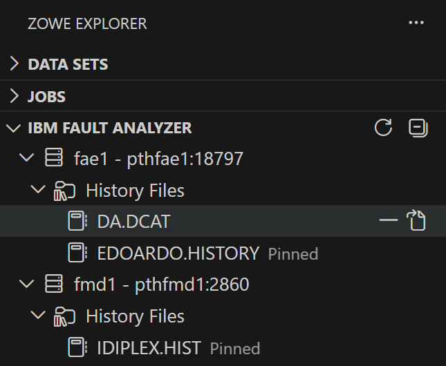
  <br>
  <small>The IBM Fault Analyzer tree view</small>
</p>

**Connection nodes** display each ADFz Common Component host and port connection.

**History Files nodes** contain the history files associated with a connection.

- Pinned history files configured in `zfaultanalyzer.pinnedHistoryFiles` appear automatically.
- Click the **Add History File** inline button or select the option from the context menu to provide
  a data set name. This action opens the new history file and adds it to the tree view.

**History File nodes** represent individual history files associated with the connection.

- Click the **Open History File** inline button or select the option from the context menu to open
  the history file. If the file is already open, this action puts it into focus.
- Click the **Remove History File** inline button or select the option from the context menu to remove
  the history file from the **IBM Fault Analyzer** tree.

#### Opening a history file from the Data Sets tree

History files can also be added from the Zowe Explorer **Data Sets** tree:

1. In the Zowe Explorer **Data Sets** tree view, click the **Search Data Sets** inline button or select
   the option from the context menu item for a specific profile.
2. Select an existing filter or create a new filter to display the history file that you want to add to
   the **IBM Fault Analyzer** tree view.
3. Right-click the history file and select **IBM Fault Analyzer** > **Open History File**.
4. If an ADFz Common Component connection is not yet defined for this profile, provide the connection
   information when prompted. A new connection is created in the **IBM Fault Analyzer** tree view.
5. The history file is opened in a new tab and is displayed in the **IBM Fault Analyzer** tree view
   if it does not already exist.

<p align="center">
  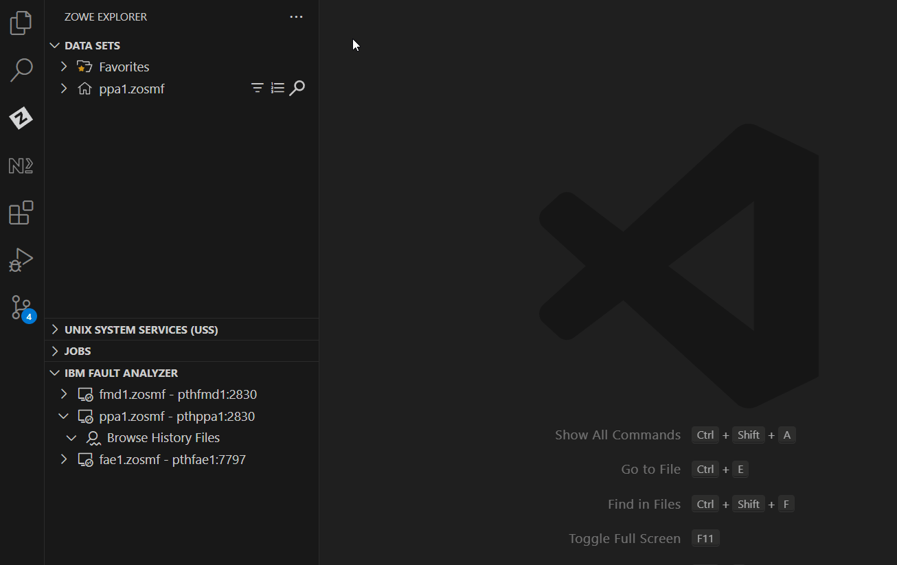
  <br>
  <small>Opening a history file from the Data Sets view</small>
</p>

#### Opening a history file from the command palette

Run **IBM Fault Analyzer: Open History File**. The wizard suggests the configured default history file,
pinned history files, and the 10 most recently used history files. Selected data sets are validated before
they are opened.

1. Select a Zowe profile that has an associated ADFz Common Component connection.
2. Select or enter the history file data set name.

The history file opens in a new tab and is added to the **IBM Fault Analyzer** tree.

<p align="center">
  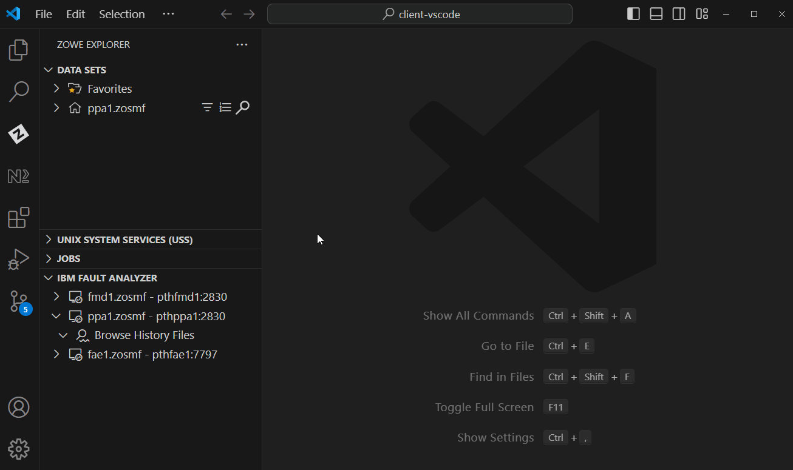
  <br>
  <small>Opening a history file from the command palette</small>
</p>

#### Creating a history file

Run **IBM Fault Analyzer: Create History File** from the command palette and select the Zowe profile
on which to create the file. Use this command when the history file does not yet exist on the host.

The wizard lets you configure:

- The data set name and type: Library or Partitioned Data Set (PDS).
- Primary and Secondary space allocation in cylinders.
- The prefix used to generate fault entry IDs.
- The minimum number of entries before automatic space management for a Library,
  or the maximum number of entries maintained in a PDS.

<p align="center">
  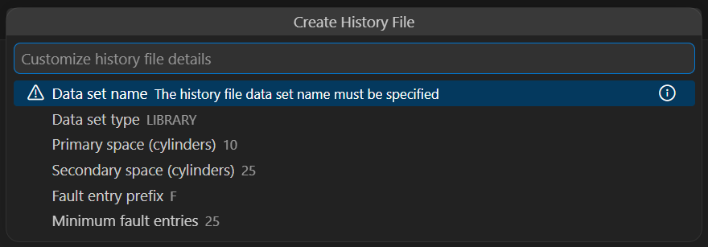
  <br>
  <small>Creating a history file from the command palette</small>
</p>

### Working with fault entries

Click a history file in the **IBM Fault Analyzer** tree to open its fault entries in a separate view.

In the history file view, use the **Refresh** button to retrieve the latest fault entries without
closing and reopening the view. Use the **Columns** menu to show or hide columns, drag them into a
different order, or reset them.

<p align="center">
  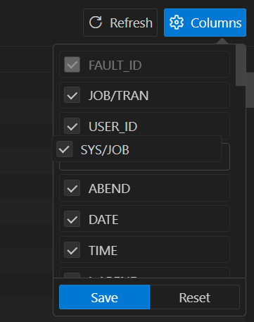
  <br>
  <small>Reordering history file columns</small>
</p>

Right-click a fault entry row to use the following actions:

- **Reanalyze** the fault entry and open its fault report.
- **Copy** or **Move** the fault entry to another history file.
- **Delete** the fault entry from the history file.

<p align="center">
  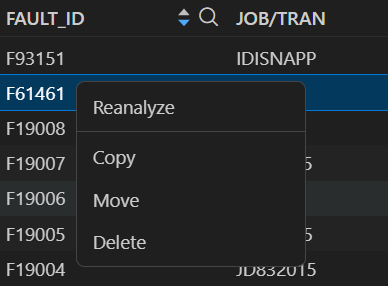
  <br>
  <small>Opening the fault entry context menu</small>
</p>

If a copy, move, or delete operation fails because the fault entry is locked, the extension can unlock
the entry and retry the operation.

### Opening fault reports

Fault reports can be opened from a history file, from the Zowe Explorer **Jobs** tree, a JESMSGLG editor, or the command palette.

#### From a history file

Double-click a fault entry row, or right-click the row and select **Reanalyze**.

<p align="center">
  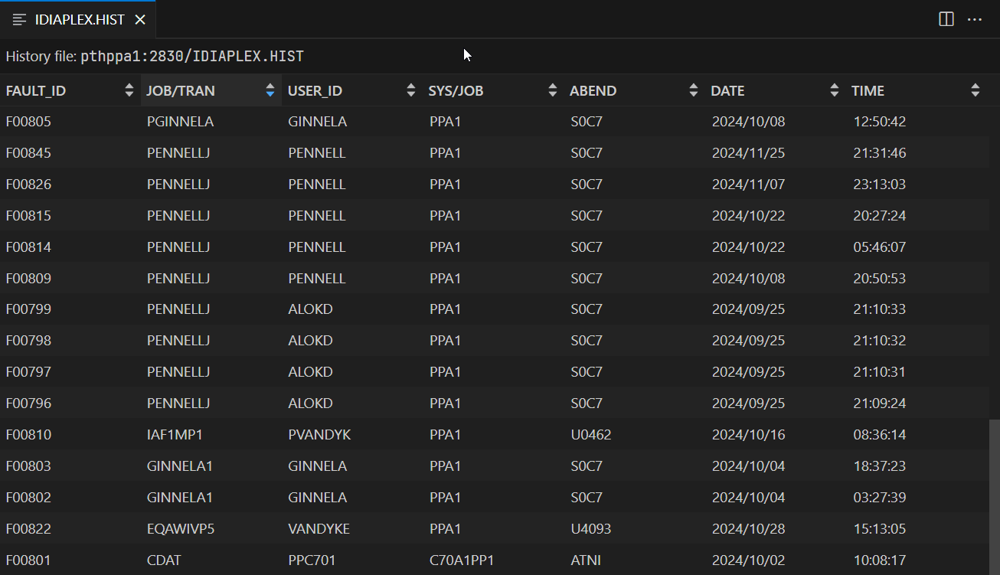
  <br>
  <small>Opening a fault report from a history file's fault entry</small>
</p>

#### From the Zowe Explorer Jobs tree

When a job generates one or more ABENDs, you can display the fault report from the Zowe Explorer
**Jobs** tree view by using any of the following methods:

**From the job node**

1. Right-click the job that completed with an ABEND.
2. Select **IBM Fault Analyzer** > **Open Fault Report**.

> Note: if a job has more than one ABEND, you are prompted to select the fault report you want to open.

<p align="center">
  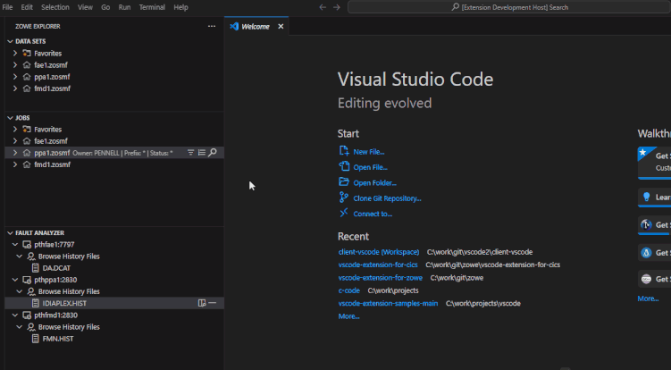
  <br>
  <small>Opening a fault report from the Jobs tree node</small>
</p>

**From JESMSGLG hyperlinks**

1. Expand the tree node for the job that ended with an ABEND.
2. Click on the **JES2:JESMSGLG** output data set to open it.
3. Hyperlinks display for each ABEND. To open the fault report for an ABEND, hold `Ctrl` (`Cmd` on macOS)
   and click the associated hyperlink.

<p align="center">
  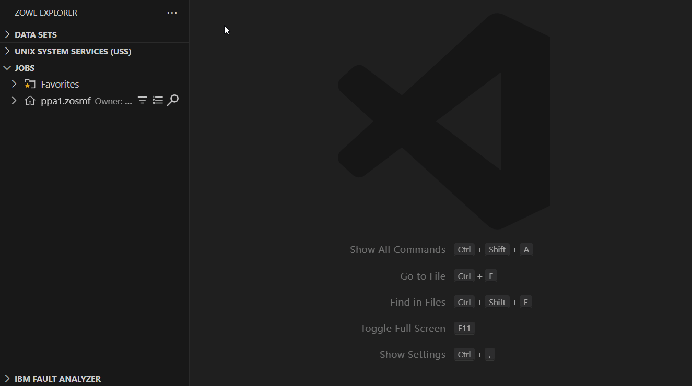
  <br>
  <small>Opening a fault report from JESMSGLG hyperlinks</small>
</p>

**From the JESMSGLG context menu**

1. Expand the tree node for the job that ended with an ABEND.
2. Click on the **JES2:JESMSGLG** output data set to open it.
3. Open the editor context menu and select **Open Fault Report**.

<p align="center">
  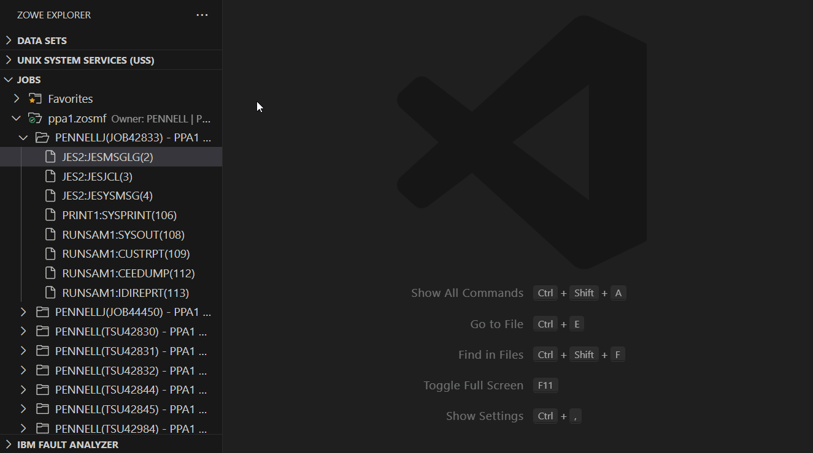
  <br>
  <small>Opening a fault report from the JESMSGLG context menu</small>
</p>

#### From the command palette

Run **IBM Fault Analyzer: Open Fault Report**.
The wizard shows all entries from the selected history file and the 10 most recently used fault entry IDs.

1. Select a Zowe profile that has an associated ADFz Common Component connection.
2. Select or enter the history file data set name.
3. Select or enter the fault entry ID.

<p align="center">
  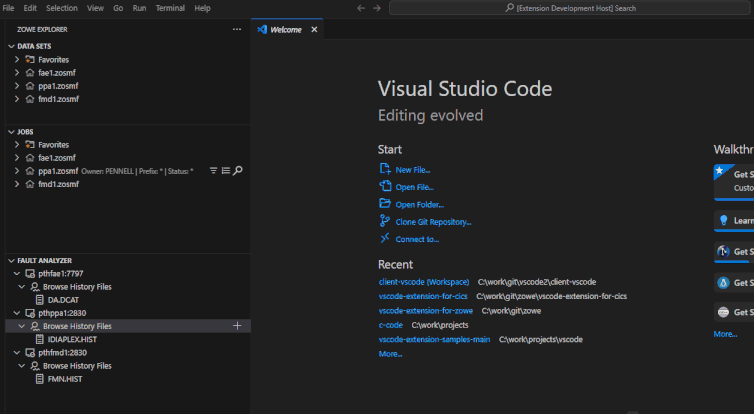
  <br>
  <small>Opening a fault report from the command palette</small>
</p>

### Navigating fault reports

The fault report view is a collection of tabs that provide access to the different sections of the report.

- In the **Event Details** section, you can click event hyperlinks to jump to specific event definitions.
- Data set hyperlinks can be opened with [IBM File Manager for z/OS][vscode-fm], if it is installed.
- Source-code hyperlinks open the associated source file at the designated line.

Use the **Reanalyze Fault Entry** editor action to refresh the active report with the configured [analysis options](#analysis-options).

<p align="center">
  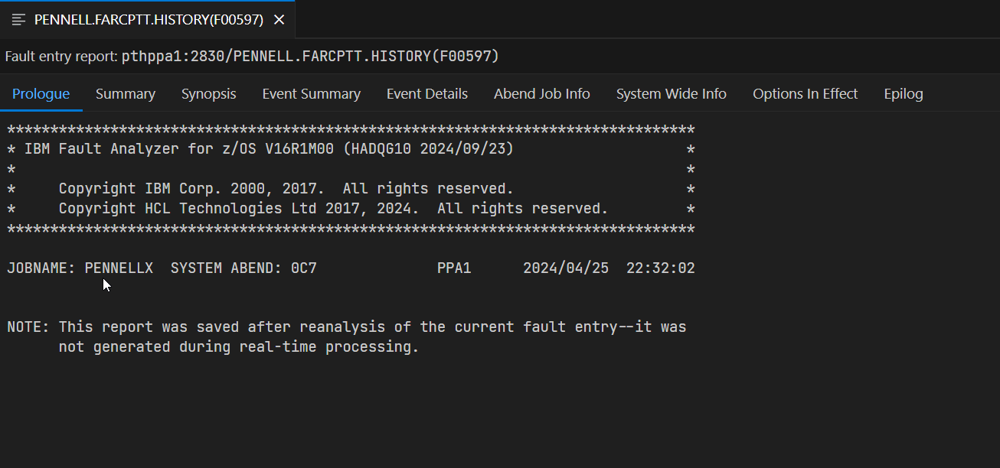
  <br>
  <small>Overview of the fault report view</small>
</p>

## Enabling the AI integration

The extension also provides an **experimental** integration with the built-in VS Code Chat experience.

The experimental integration is off by default, and can be enabled by setting `zfaultanalyzer.ai.enabled` to `true`
and then restarting VS Code. The enabled components include:

- **MCP Server**: provides tools to allow LLMs to interact with history files, fault entries, and fault reports
  when prompting in a Chat session.
- **Chat Participant**: provides a `@fault-analyzer` participant for questions about using the extension.
- **Context Contributors**: provide Chat context items for recently used history files and fault entries,
  and for the active history-file or fault-report tab.

  **Important**: Context Contributors require VS Code Insiders. See [Injecting Chat context items](#injecting-chat-context-items) for more details.

### Using the Chat Participant

In a Chat session, tag the **IBM Fault Analyzer** Chat Participant with `@fault-analyzer` to ask
questions about how to use the extension. For example, you may want to know how to open a history file,
how to find a fault entry, how to navigate a fault report, or how to report unexpected behavior.

The Chat Participant is mostly intended for extension how-to questions at the moment, but it may be
expanded to other use cases in the future, such as assisting with host-related questions, or being
able to automate specific UI workflows.

For information about history files, fault entries, or fault reports, prompt directly in Chat as described below.

### Prompting for history files and fault reports

Tagging `@fault-analyzer` is not necessary to retrieve information from history files, fault entries, or fault reports.
The MCP Server makes tools available to the chat model, which can use them when appropriate.

For example, ask for entries in `HISTORY.FILE.NAME`, or for a summary of the report for `HISTORY.FILE.NAME(FAULTID)`.

If you do not specify a Zowe profile, the tools use the only profile with a configured connection,
or ask you to select one when several are available.

### Injecting Chat context items

The extension uses the proposed [Contributable Chat Context API][chat-context-api] to provide [Chat context][chat-context]
in two ways:

- Explicit attachments: select a recently used history file or fault entry via **Add Context...** in the Chat input box.
- Implicit attachments: the active history file or fault report tab provides a context item automatically.

These context items identify the resource and its Zowe profile. They do not contain the resources themselves, but allow
the selected chat model to invoke MCP tools to retrieve them when needed.

Because the API is still under development, these features require VS Code Insiders and an Insiders-enabled `.vsix` file.
Download [VS Code Insiders][vscode-insiders], then download the Insiders-enabled `.vsix` from the [GitHub Releases][github-releases]
page and manually install it.

## Getting help

To ask questions or report issues related to the installation, configuration,
or use of this extension, contact [IBM Support][ibm-support].

### Zowe Explorer issues

The IBM Fault Analyzer extension depends on Zowe Explorer.  
Issues might originate from core Zowe Explorer functionality rather than the extension itself.
Examples include:

- Data set and Unix System Services (USS) file browsing
- Job management and submission
- Base Zowe Explorer commands and views

Report issues that are specific to Zowe Explorer to the Zowe Explorer [issue tracker][zowe-support].

To determine the source of an issue and the appropriate reporting channel, consider the following:

- Error notifications include the extension name.
- Log entries displayed in the **Output** view are categorized by extension.

[vscode]: https://code.visualstudio.com
[vscode-insiders]: https://code.visualstudio.com/insiders
[vscode-pack]: https://marketplace.visualstudio.com/items?itemName=IBM.application-delivery-foundation-for-zos-vscode-extension-pack
[vscode-cc]: https://marketplace.visualstudio.com/items?itemName=IBM.zcommoncomponent
[vscode-fa]: https://marketplace.visualstudio.com/items?itemName=IBM.zfaultanalyzer
[vscode-fm]: https://marketplace.visualstudio.com/items?itemName=IBM.zfilemanager
[vscode-zowe]: https://marketplace.visualstudio.com/items?itemName=Zowe.vscode-extension-for-zowe
[vscode-openeditor]: https://marketplace.visualstudio.com/items?itemName=IBM.zopeneditor
[fa-home]: https://www.ibm.com/products/fault-analyzer-for-zos
[fa-docs]: https://help.blueproddoc.com/faultanalyzer/16.1.0/en/index.html
[fa-install]: https://help.blueproddoc.com/faultanalyzer/hadqg10_FA_Program_Directory_V161.pdf
[cc-docs]: https://help.blueproddoc.com/adfz_common_components/1.10.0/en/index.html
[cc-install]: https://help.blueproddoc.com/adfz_common_components/hvwr1a0_ADFzCC_Program_Directory_V1.10.pdf
[cc-customize]: https://help.blueproddoc.com/adfz_common_components/1.10.0/en/svrauth.html
[cc-attls]: https://help.blueproddoc.com/adfz_common_components/1.10.0/en/attls.html
[github-issues]: https://github.com/IBM/fa-vs-code-extension/issues
[github-releases]: https://github.com/IBM/fa-vs-code-extension/releases
[ibm-support]: https://www.ibm.com/mysupport/
[zowe-support]: https://github.com/zowe/zowe-explorer-vscode/issues
[chat-context]: https://code.visualstudio.com/docs/chat/copilot-chat-context
[chat-context-api]: https://github.com/microsoft/vscode/blob/main/src/vscode-dts/vscode.proposed.chatContextProvider.d.ts
